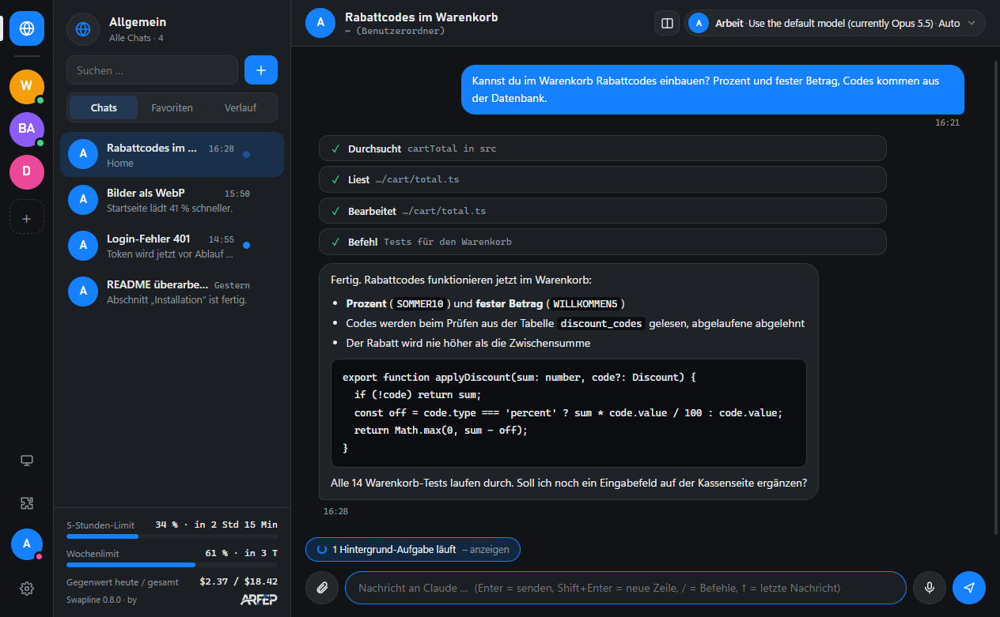
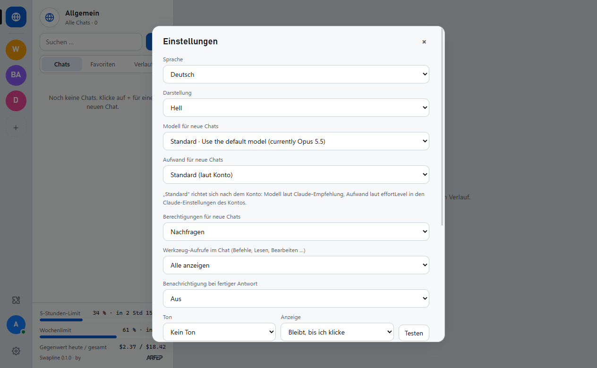
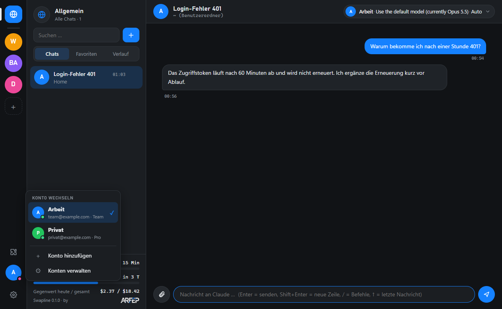

# Swapline

**Claude Code im Messenger-Stil – mit Kontowechsel per Klick.**

Swapline ist eine Windows-Desktop-App für [Claude Code](https://code.claude.com/docs). Statt im Terminal chattest du wie in einer Nachrichten-App: Sprechblasen, Markdown, einklappbare Werkzeug-Aufrufe, Rückfragen als Buttons. Mehrere Claude-Konten (Pro, Max, Team, Enterprise) liegen nebeneinander und lassen sich mit einem Klick wechseln, ohne erneute Anmeldung.

by **ARFEP IT-Service**, Göttingen – https://arfep.de

<p align="center">
  
</p>

## Funktionen

- **Projekte:** Leiste links mit „Allgemein“ (🌐) und eigenen Projekten, auf Wunsch in Ordnern gruppiert (auf-/zuklappbar); Chats per Ziehen oder Rechtsklick zuordnen, optional mit Projektordner.
- **Konten wechseln:** über das Profil links unten oder `Strg+1…9`. Jedes Konto hat einen eigenen Konfigurationsordner (`~/.claude-profiles/<konto>`), angemeldet wird einmalig.
- **Chat mit anderem Konto fortsetzen:** Konto im Chat wechseln, der Verlauf wird nach Rückfrage übernommen (siehe [Daten und Anmeldung](#daten-und-anmeldung)).
- **Mehrere Chats gleichzeitig**, auch mit verschiedenen Konten und Ordnern; Ungelesen- und „arbeitet“-Anzeige.
- **Verlauf:** alle bisherigen Claude-Code-Sitzungen des Kontos (auch aus dem Terminal), nach Datum gruppiert, durchsuchbar und fortsetzbar.
- **Nutzung:** 5-Stunden- und Wochenlimit des Abos mit Reset-Zeit, geschätzter API-Gegenwert pro Tag – beides aus der Ausgabe von Claude Code.
- **Chat-Einstellungen** in einem Menü oben rechts: Konto, Modell, Aufwand, Berechtigungen (Nachfragen, Änderungen erlauben, Nur planen, Alles erlauben).
- **Rückfragen als Karten:** Erlauben / Immer erlauben / Ablehnen, Fragen von Claude mit Antwortmöglichkeiten, Plan-Modus mit „Plan annehmen / Überarbeiten / Ablehnen“.
- **Eingabe wie im Terminal:** /-Befehle mit Auswahlliste (Befehle und Skills des Kontos), Eingabe-Verlauf mit ↑/↓, Bilder und Dateien per Büroklammer, Strg+V oder Ziehen.
- **Hintergrund-Aufgaben** (z. B. Befehle mit `run_in_background`, Agenten) als Leiste über dem Eingabefeld, mit Status und Ausgabe; der Chat bleibt als aktiv markiert, solange eine Aufgabe läuft.
- **Suche:** offene Chats inklusive Nachrichtentext, im Verlauf Volltextsuche durch alle Sitzungen.
- **Erweiterungen:** Plugins aus den Marktplätzen installieren, aktivieren, deaktivieren und entfernen, Skills und Befehle des Kontos ansehen.
- **Anzeige nach Wunsch:** Werkzeug-Aufrufe alle, kompakt oder ausgeblendet; Recap („während du weg warst“); Antworten und Code kopieren; Chats umbenennen; Hell/Dunkel; Deutsch/Englisch.
- **Benachrichtigungen:** Windows-Benachrichtigung bei fertiger Antwort oder Rückfrage, auf Wunsch bis zum Klick sichtbar, mit wählbarem Ton.
- **Fernzugriff:** Chats und Konten dieses PCs von einem anderen eigenen PC mit Swapline nutzen – im Netzwerk oder übers Internet (siehe [Fernzugriff](#fernzugriff)).
- **Updates** aus den GitHub-Releases: Hinweis bei neuer Version, Installation per Klick (wahlweise automatisch oder aus).

<p align="center">
  
  
</p>

## Voraussetzungen

- Windows 10/11 (x64)
- [Claude Code](https://code.claude.com/docs) installiert (`claude --version`). Fehlt es, zeigt Swapline „Claude Code nicht gefunden“.

## Installation

**Mit Installer (empfohlen):** `Swapline-Setup-<Version>.exe` von den [Releases](https://github.com/ARFEP-IT-Service/Swapline/releases) laden und starten. Swapline wird ohne Admin-Rechte für den aktuellen Benutzer nach `%LOCALAPPDATA%\Programs\swapline` installiert, mit Verknüpfung im Startmenü und auf dem Desktop, und startet danach. Swapline prüft selbst bei GitHub, ob es eine neue Version gibt, und meldet sie mit „Version X verfügbar“; geladen wird erst nach Klick auf **Herunterladen** (Standard „Nur benachrichtigen“). Danach fragt Swapline **Jetzt neu starten** oder **Später** – mit „Später“ wird das Update beim nächsten Beenden installiert, ohne Neustart. Unter **Einstellungen → Updates** lässt sich stattdessen **Automatisch** (im Hintergrund laden, beim Neustart installieren) oder **Aus** wählen. Alternativ den neueren Installer starten – er ersetzt die vorhandene Version im selben Ordner. Deinstalliert wird über **Einstellungen → Apps → Installierte Apps → Swapline**. Einstellungen und Konten bleiben dabei erhalten.

**Ohne Installer:** `Swapline-<Version>-windows.zip` in einen festen Ordner entpacken und `Swapline.exe` starten. Diese Variante aktualisiert sich nicht selbst.

> **Hinweis:** Installer und exe sind nicht digital signiert. Windows SmartScreen zeigt deshalb beim ersten Start „Der Computer wurde durch Windows geschützt“. Über **Weitere Informationen → Trotzdem ausführen** startet die App.

Das bestehende Claude-Code-Konto erscheint als „Standard“. Weitere Konten: Profil links unten → **Konto hinzufügen** → Name eingeben → Claude Code öffnet deinen Standard-Browser mit der Anmeldeseite von Anthropic → dort anmelden. Ist im Browser schon ein anderes Claude-Konto angemeldet, ein privates Fenster verwenden. Verlangt Claude Code einen Code, öffnet Swapline auf Wunsch ein Konsolenfenster mit `claude auth login`, in das du den Code selbst eingibst.

## Fernzugriff

Ein PC mit Swapline kann **Haupt-PC** sein: Andere eigene Geräte mit Swapline verbinden sich und nutzen dessen Chats und Claude-Konten – Claude läuft dabei auf dem Haupt-PC, die Anmeldedaten bleiben dort. So geht's:

1. **Haupt-PC:** Fernzugriff-Symbol links (Bildschirm) → **Fernzugriff einrichten …** → **Fernzugriff erlauben** (Port 47820, änderbar). Windows fragt beim ersten Mal, ob Swapline Verbindungen annehmen darf – für private Netzwerke erlauben.
2. **Gerät koppeln …** zeigt einen Einmal-Code (5 Minuten gültig).
3. **Anderes Gerät:** Fernzugriff einrichten → **Mit einem Haupt-PC verbinden** → Adresse, Port und Code eingeben. Am Haupt-PC das Koppeln bestätigen.
4. Gekoppelte Haupt-PCs bleiben im Hintergrund verbunden und stehen links in der Leiste unter den Projekten. Ihre Chats laufen neben den eigenen: **Allgemein** zeigt alle Chats zusammen (Haupt-PC-Chats mit 🖥 markiert), ein Klick auf den Haupt-PC zeigt nur dessen Chats und Verlauf, **+** startet dort einen neuen Chat mit dessen Konten und Ordnern. Am Haupt-PC **offene Chats** erscheinen automatisch; wer einen davon öffnet, tritt dem laufenden Chat bei – beide PCs sehen dieselben Antworten und können abwechselnd schreiben.

**Freigabe je Gerät:** In der Geräteliste unter **Freigabe …** festlegen, was ein Gerät sieht – alle oder nur ausgewählte **Konten**, alle oder nur ausgewählte **Projekte** (alle Chats in deren Ordnern, neue Chats nur dort) und einzelne **Chats**. Einzelne Chats lassen sich auch per Rechtsklick auf den Chat → **Für Gerät freigeben …** teilen. Der Haupt-PC prüft die Freigabe bei jeder Anfrage; wird sie verkleinert, enden laufende Chats des Geräts, die nicht mehr freigegeben sind. Zugriff entziehen: Freigabe ändern, Gerät **Entfernen** (sofort getrennt) oder **Fernzugriff erlauben** ausschalten.

**Übers Internet:** am einfachsten mit [Tailscale](https://tailscale.com) (beide PCs im selben Tailnet, Adresse 100.x.x.x) – der Haupt-PC bleibt fürs Internet unsichtbar. Alternativ am Router den Port per Weiterleitung auf den Haupt-PC lenken und die öffentliche Adresse bzw. einen DynDNS-Namen verwenden; der Port ist dann aus dem ganzen Internet erreichbar und nur durch Verschlüsselung und Kopplung geschützt.

**Sicherheit:** Verbindung per TLS 1.2 mit eigenem 256-Bit-Schlüssel je Gerät (TLS-PSK mit ECDHE, beide Seiten prüfen sich gegenseitig). Der Schlüssel entsteht beim Koppeln und wird auf beiden PCs nur verschlüsselt (Windows-Datenschutz-API) gespeichert. Wiederholte Fehlversuche einer Adresse werden für 10 Minuten gesperrt. Ein Gerät kann Chats führen, Rückfragen beantworten und – solange in der Geräteliste erlaubt – „Alles erlauben“ nutzen; Konten, Projekte, Plugins und Einstellungen des Haupt-PCs ändern kann es nicht. Geräte lassen sich jederzeit entfernen. **Nur eigene Geräte koppeln** – das Teilen eines Claude-Kontos mit anderen Personen erlauben Anthropics Bedingungen nicht.

## Daten und Anmeldung

- **Anmeldung:** ausschließlich über `claude auth login`, also Anthropics eigenen Ablauf im System-Browser. Swapline zeigt keine Anmeldeseite an, liest dabei keine Ausgabe und sieht weder Passwort noch Code noch Token.
- **Zugangsdaten:** Swapline liest, speichert oder überträgt keine Zugangsdaten oder Tokens. Claude Code legt sie selbst in seinem Konfigurationsordner ab; Swapline legt pro Konto nur fest, welcher Ordner das ist (Umgebungsvariable `CLAUDE_CONFIG_DIR`).
- **Anfragen an Claude:** laufen immer über das unveränderte, installierte Claude-Code-Programm (`claude -p --input-format stream-json …`). Swapline selbst sendet keine Telemetrie und lädt keine Remote-Bilder; https-Links öffnet es im Standard-Browser.
- **Eigene Netzverbindungen:** nur der Fernzugriff (wenn eingeschaltet, siehe oben) und die Update-Prüfung.
- **Update-Prüfung:** Die installierte App fragt beim Start und alle 6 Stunden bei GitHub (`github.com/ARFEP-IT-Service/Swapline`, Release-Daten `latest.yml`) nach einer neuen Version. Geladen wird die neue Version ebenfalls von dort – im Standard „Nur benachrichtigen“ erst nach deinem Klick. Dabei werden keine Konto- oder Nutzungsdaten übertragen. Abschaltbar unter **Einstellungen → Updates** (Aus); die ZIP-Variante und der Start aus dem Quellcode prüfen nie.
- **„Alles erlauben“:** Die Warnung erscheint bewusst nur beim ersten Einschalten; die Zustimmung wird gespeichert und lässt sich in den Einstellungen zurücksetzen.
- **Verlauf:** Swapline liest die Sitzungsdateien von Claude Code (`<Konfigurationsordner>/projects/…/*.jsonl`), um alte Chats anzuzeigen und fortzusetzen.
- **Chat in ein anderes Konto übertragen:** kopiert die Sitzungsdatei (gesamter Verlauf inkl. Dateiinhalten und Befehlsausgaben) in den Ordner des anderen Kontos – keine Zugangsdaten. Vorher fragt Swapline nach. Nicht zwischen Firmen- und Privatkonten übertragen.
- **Lokal gespeichert** (`%APPDATA%\Swapline`): Konten-, Projekt- und App-Einstellungen, Chat-Liste mit Titeln, Nutzungswerte, Fehlerprotokoll `swapline.log`.

## Entwicklung

```bash
git clone https://github.com/ARFEP-IT-Service/Swapline.git
cd Swapline
npm install
npm start                 # App aus dem Quellcode starten
npm test                  # Tests: Sicherheit und Oberfläche (ohne Netz, ohne Claude-Aufrufe)
npm run dist              # licenses/ erzeugen, bauen, prüfen → dist/Swapline-Setup-<Version>.exe + dist/Swapline-<Version>-windows.zip
```

`npm run dist` sammelt die Lizenztexte (`tools/collect-licenses.js`), baut mit electron-builder den Installer (NSIS, pro Benutzer) und die Ordner-Variante als ZIP und prüft danach, dass jedes gebündelte Paket einen Lizenztext hat (`tools/check-bundle.js`).

Testprofil, damit die echten Einstellungen unberührt bleiben (wirkt nur beim Start aus dem Quellcode, nicht in der gebauten App):

```bash
SWAPLINE_PROFILE=test npm start
```

| Datei | Inhalt |
|---|---|
| `src/main.js` | Hauptprozess: Konten, Start von Claude Code pro Chat, Verlauf, Nutzung, Prüfung aller Eingaben der Oberfläche |
| `src/preload.js` | Brücke zwischen Oberfläche und Hauptprozess |
| `src/renderer/` | Oberfläche (HTML/CSS/JS ohne Framework), Markdown über marked + DOMPurify |
| `src/renderer/i18n.js` | Übersetzungen (Deutsch ist Quelltext, Englisch als Wörterbuch) |
| `tests/` | Testlauf (`tests/run.js`) und Testdateien (`tests/ui/*.test.js`) |
| `tools/` | Lizenzsammlung, Bundle-Prüfung, Release-Hilfen |
| `.github/workflows/` | CI (Tests + Build) und Release (Tests, Build, Prüfsummen, Veröffentlichung) |
| `src/renderer/assets/swapline.ico`, `.svg` | App-Icon (exe, Fenster, Taskleiste, Benachrichtigungen, README) |

Wie man mitmacht: [CONTRIBUTING.md](CONTRIBUTING.md).

## Versionen

Swapline folgt [Semantic Versioning](https://semver.org/lang/de/) (MAJOR.MINOR.PATCH). Die Nummer steht nur in `package.json`; Änderungen je Version in [CHANGELOG.md](CHANGELOG.md). Ein Tag `vX.Y.Z` baut über GitHub Actions einen Release und veröffentlicht ihn selbst, sobald Tests und Build bestanden sind: Versionen ohne Zusatz (z. B. 0.1.2) als „Latest“ – installierte Apps bekommen das Update –, Versionen mit Zusatz (z. B. 0.2.0-beta.1) als Pre-release, die installierte Apps nicht anbieten. Schlägt ein Schritt fehl, entsteht kein Release.

## Lizenz

[MIT](LICENSE) – Copyright (c) 2026 Halil Ayberk Bulut (ARFEP IT-Service) and Swapline contributors.

Drittkomponenten (Electron, Chromium, FFmpeg, marked, DOMPurify, electron-updater) siehe [THIRD_PARTY_NOTICES.md](THIRD_PARTY_NOTICES.md); die Volltexte liegen im Release im Ordner `licenses/`. Das ARFEP-Logo in `src/renderer/assets/arfep/` steht **nicht** unter MIT (siehe [NOTICE](src/renderer/assets/arfep/NOTICE.md)).

Inoffizielles Projekt, nicht mit Anthropic verbunden. „Claude“ und „Claude Code“ sind Marken von Anthropic, PBC.

Impressum / Legal notice: arfep.de/impressum
